# SudaNet Enterprise Network: Automation, Proactive Defense, Routing & Switching
## مشروع شبكة سودانيت المؤسسية: الراوترات، السويتشات، الأتمتة، الدفاع الاستباقي، والمراقبة
**Author:** Mahmoud Mohamed Saeed | IT & Network Engineer | Network Automation & Cybersecurity  
**GitHub:** [github.com/mahamud199](https://github.com/mahamud199) | **LinkedIn:** [linkedin.com/in/mahmoud-engineer](https://linkedin.com/in/mahmoud-engineer)

---

## 🌟 Overview / نظرة عامة شاملة على المشروع

**SudaNet** is an enterprise-scale multi-site network infrastructure designed and simulated on **EVE-NG**, integrating:
1. **Cisco Routing & Multilayer Switching (هندسة الراوترات والسويتشات):** Core & Distribution Layer switching (Core-SW1, Core-SW2, Dist-SW1, Dist-SW2), Cisco IOS CLI management, Dynamic OSPF/BGP routing, VLANs, EtherChannel, and HSRP high availability.
2. **Network Automation (أتمتة الشبكات بالبايثون):** Automated device provisioning, dynamic VLAN generation, automated configuration backups, and HSRP failover via Python and Netmiko.
3. **Proactive Cyber Defense (الدفاع الاستباقي ومصيدة الاختراق):** Cowrie SSH Honeypot capturing intruder behavior in the DMZ, integrated with an Elasticsearch / Kibana analytics pipeline.
4. **Automated Threat Isolation (عزل التهديدات تلقائياً):** Event-driven Python scripts injecting dynamic ACL blocks on Cisco edge routers upon confirmed threat alerts.
5. **Perimeter Security & Privacy (الأمن المحيطي):** pfSense firewalls enforcing DMZ server zone isolation, stateful filtering, and Site-to-Site IPsec VPN encrypted tunnels.
6. **Infrastructure Observability (المراقبة الشاملة):** Real-time Zabbix monitoring tracking host health, network interfaces, CPU utilization, and SLA deviations.
7. **Enterprise Identity & Systems (إدارة الهوية والأنظمة):** Windows Server Active Directory Domain Services, DNS Forward/Reverse Zones, and DHCP scopes for centralized control.

---

## 📸 Selected Evidence Gallery & Technical Explanations (شرح الصور الـ 25 المختارة)

---

### [القسم الأول: راوترات وسويتشات سيسكو وسطر الأوامر (Cisco Routing & Switching CLI)]

#### 1. Cisco Core Multilayer Switch 2 CLI (سويتش الطبقة المركزية Core-SW2)
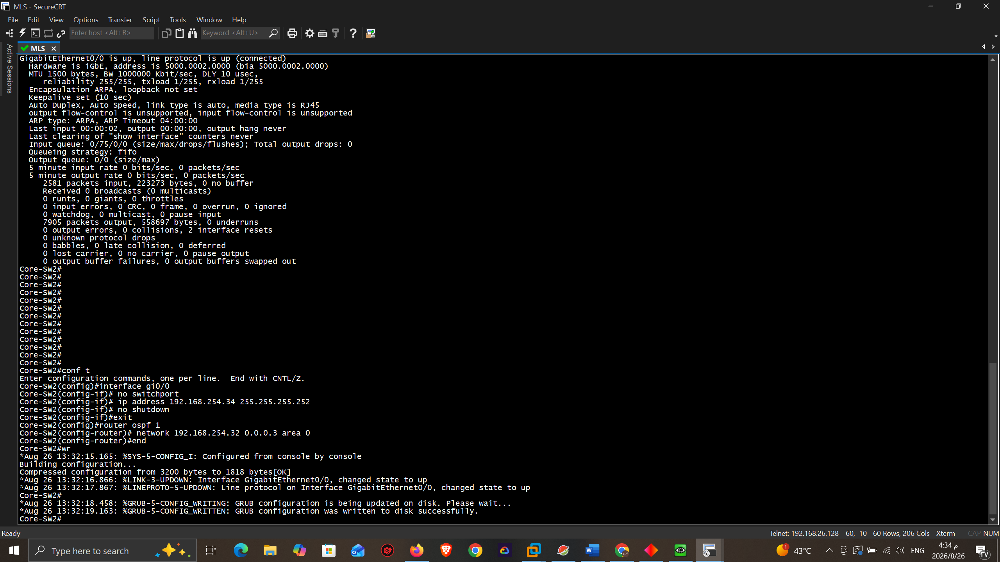
* **الصورة:** `19_Cisco_Core_Switch_2_CLI.png`
* **المجال:** محولات الطبقة الثالثة والتحويل المركزي (Core Layer Switching).
* **الشرح التقني:** لقطة حية من برنامج **SecureCRT** توضح الوصول إلى سويتش القلب (`core-sw2#`)، وهو سويتش من الطبقة الثالثة (Multilayer Switch L3) يتولى التوجيه السريع بين شبكات الـ VLANs، وتفعيل قنوات الربط السريعة (EtherChannel)، وبروتوكول HSRP لضمان عدم انقطاع الشبكة في حال تعطل السويتش الرئيسي الأول.
* **التقنيات المستخدمة:** Cisco Catalyst Multilayer Switch, Cisco IOS, SecureCRT, L3 Routing.

---

#### 2. Cisco Distribution Switch 1 CLI (سويتش التوزيع Dist-SW1)
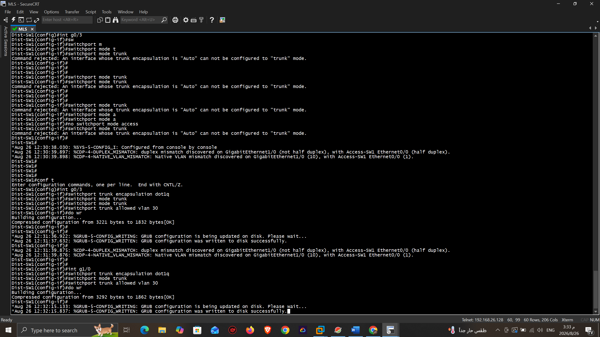
* **الصورة:** `20_Cisco_Distribution_Switch_1_CLI.png`
* **المجال:** طبقة التوزيع وسياسات التوجيه (Distribution Layer Switching).
* **الشرح التقني:** سطر أوامر سويتش التوزيع الأول (`Dist-SW1#`)، المسؤول عن تجميع حركة المرور من سويتشات الوصول (Access Switches) وتطبيق سياسات التوجيه الداخلي وحماية الشبكة من حلقات التكرار (Spanning Tree Protocol).
* **التقنيات المستخدمة:** Cisco IOS, SecureCRT CLI, STP, Trunking 802.1Q.

---

#### 3. Multilayer Switch DS2 & VLAN 30 Config (تكوين سويتش التوزيع DS2 وشبكة VLAN 30)
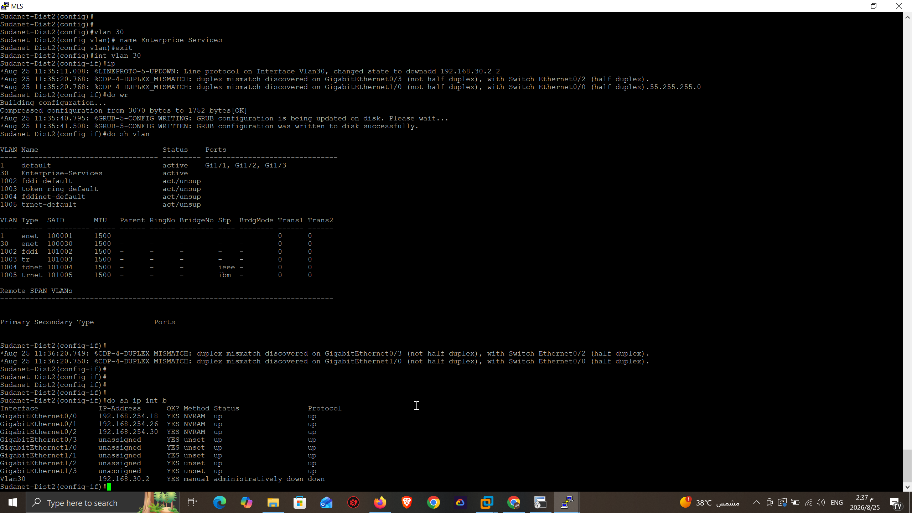
* **الصورة:** `21_Cisco_Multilayer_Switch_VLAN30.png`
* **المجال:** تكوين منافذ السويتش وشبكات الـ VLAN (Switchport & VLAN Configuration).
* **الشرح التقني:** لقطة إعدادات منافذ GigabitEthernet على محول التوزيع الثاني (MLS DS2)، وربطه بشبكة `VLAN 30` المخصصة لخدمات المؤسسة (Enterprise Services وخادم Windows Server)، ومعالجة توافق السرعات (Duplex / Speed).
* **التقنيات المستخدمة:** VLAN 30, GigabitEthernet, Switchport Access, Duplex Configuration.

---

#### 4. Cisco Core Routing & Switching Master CLI (إعدادات التوجيه الشامل لسيسكو)
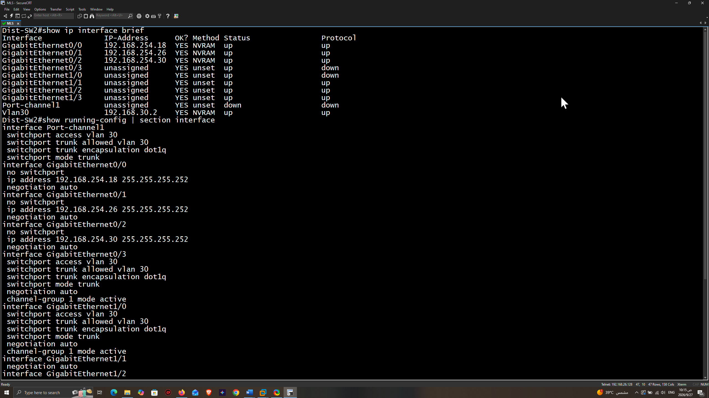
* **الصورة:** `10_Cisco_Core_Routing_Switching_CLI.png`
* **المجال:** بروتوكولات التوجيه وهندسة الشبكة (Routing Protocols & Core Switching).
* **الشرح التقني:** لقطة تفصيلية عبر SecureCRT توضح إعدادات التوجيه الديناميكي **OSPF** لربط راوترات وسويتشات المؤسسة، ضبط أولويات HSRP، وعرض جداول التوجيه وجداول الجوار (OSPF Neighbors).
* **التقنيات المستخدمة:** OSPF Dynamic Routing, HSRP Virtual IP, Cisco IOS CLI.

---

#### 5. SudaNet Main Router 1 Full Config (تكوين الراوتر الرئيسي الأول R1)
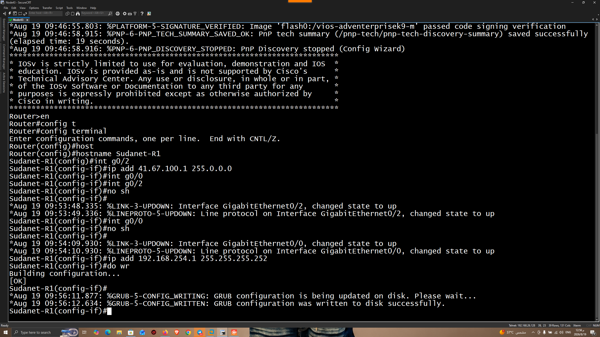
* **الصورة:** `23_SudaNet_Router1_Full_Config.png`
* **المجال:** إعدادات راوتر المقر الرئيسي (Enterprise Edge Router Configuration).
* **الشرح التقني:** استعراض ملف التكوين الكامل للراوتر الرئيسي `sudanet_R1` (Node43) في المقر الرئيسي بكوستي، موضحاً عناوين الواجهات، ربط الـ WAN مع مزود الخدمة، وتفعيل مسارات التوجيه الثابتة والديناميكية.
* **التقنيات المستخدمة:** Cisco Edge Router, Cisco IOS, Interface IP Addressing, Default Routing.

---

#### 6. Cisco Port Sudan Branch DR Router CLI (راوتر فرع بورتسودان PSD-Router)
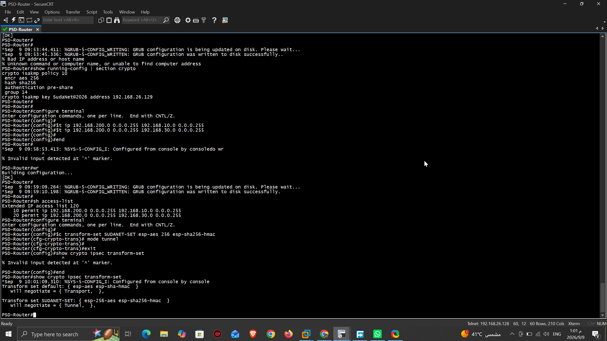
* **الصورة:** `22_Cisco_PSD_Branch_Router_CLI.png`
* **المجال:** راوترات الفروع والربط الإقليمي (Branch Office Routing).
* **الشرح التقني:** واجهة أوامر راوتر فرع بورتسودان (`PSD-Router#`) لموقع التعافي من الكوارث، موضحاً استقبال مسارات التوجيه وتهيئة واجهات الشبكة المحلية `192.168.200.0/24`.
* **التقنيات المستخدمة:** Branch Router, SecureCRT, WAN Interfaces, Disaster Recovery.

---

#### 7. Core-SW to Distribution Switch 2 Topology (ربط سويتشات القلب والتوزيع DS2)
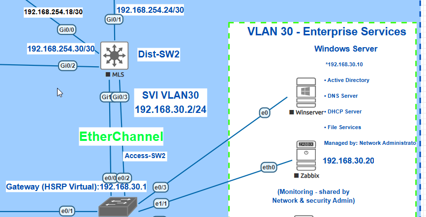
* **الصورة:** `25_Core_To_Distribution_Switch2_Topology.png`
* **المجال:** مخططات التوصيل الداخلي (Inter-Switch Trunking & Uplinks).
* **الشرح التقني:** يوضح كابلات ووصلات الربط المباشر بين سويتشات القلب (Core Switches) وسويتش التوزيع الثاني (`Dist-SW2`) عبر شبكات فرعية `/30`، ونقل حركة مرور شبكة `VLAN 30` باتجاه خادم Windows Server والخدمات الحساسة (`192.168.30.10`).
* **التقنيات المستخدمة:** Point-to-Point /30 Subnets, Inter-VLAN Routing, Uplink Redundancy.

---

#### 8. Distribution Switch 1 to Access Switch Topology (ربط سويتش التوزيع بسويتش الوصول)
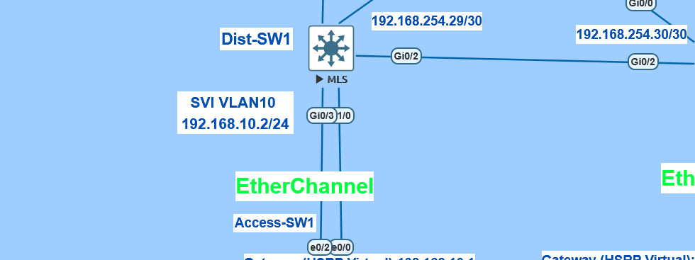
* **الصورة:** `24_Distribution_To_Access_Switch_Topology.png`
* **المجال:** ربط طبقة الوصول (Access Layer Integration).
* **الشرح التقني:** يوضح ربط سويتش التوزيع الأول (`Dist-SW1`) بسويتش الوصول (`Access-SW1`) لتزويد أجهزة الموظفين في شبكة `VLAN 10` بنطاق `192.168.10.0/24` بالاتصال السريع عبر منافذ GigabitEthernet.
* **التقنيات المستخدمة:** Cisco Access Switch, Port-Security, VLAN 10, Access Layer Ports.

---

### [القسم الثاني: المخططات الهيكلية ومعمارية الفروع (Network Topologies & Branches)]

#### 9. Overall Network Topology in EVE-NG (المخطط الهيكلي العام لشبكة سودانيت)
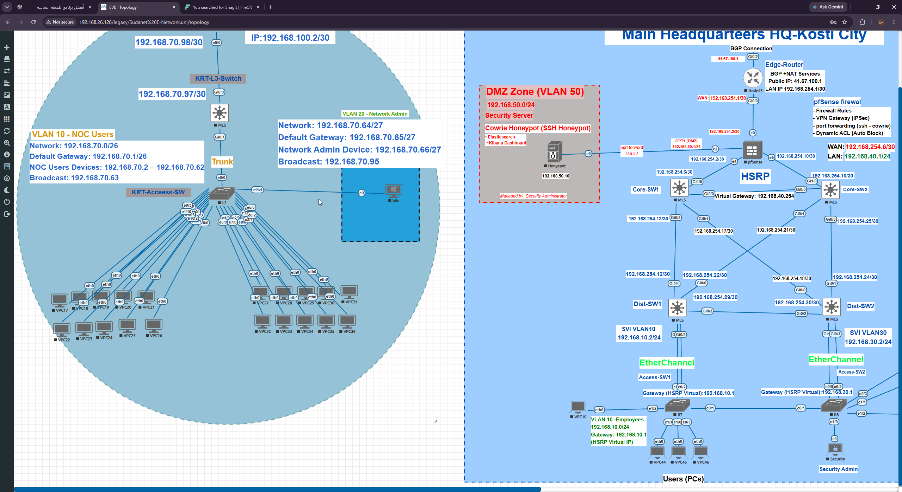
* **الصورة:** `01_SudaNet_Topology_EVE-NG.png`
* **الشرح التقني:** المخطط الهيكلي العام لشبكة **SudaNet** على محاكي **EVE-NG**، يوضح ربط المقر الرئيسي في كوستي مع مركز العمليات في الخرطوم وموقع الطوارئ في بورتسودان عبر مسارات بديلة.

#### 10. Branch 1 - Khartoum NOC Network Details (تفاصيل فرع الخرطوم NOC)
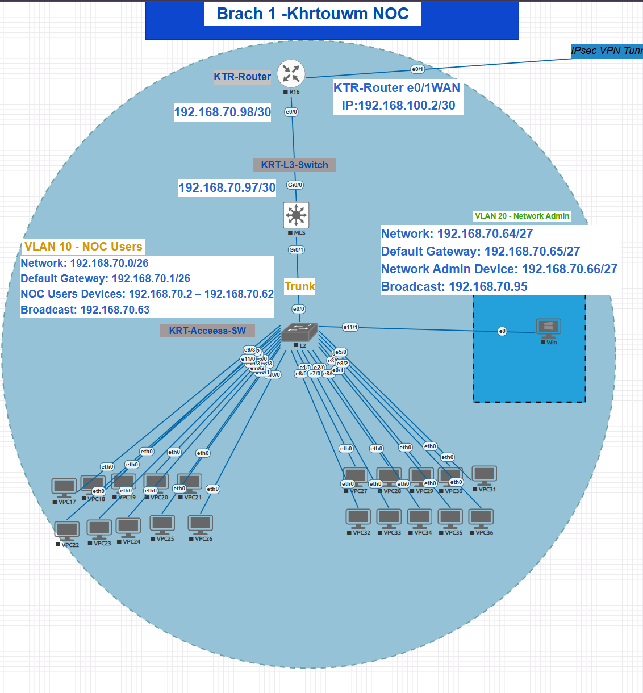
* **الصورة:** `11_Branch1_Khartoum_NOC_Topology.png`
* **الشرح التقني:** المخطط التفصيلي لفرع مركز عمليات الشبكة بالخرطوم (KTR-Router و KRT-L3-Switch)، وتخصيص شبكة مستخدمي الـ NOC على `VLAN 10` بنطاق `192.168.70.0/24`.

#### 11. Branch 2 - Port Sudan Disaster Recovery Site (موقع التعافي من الكوارث ببورتسودان)
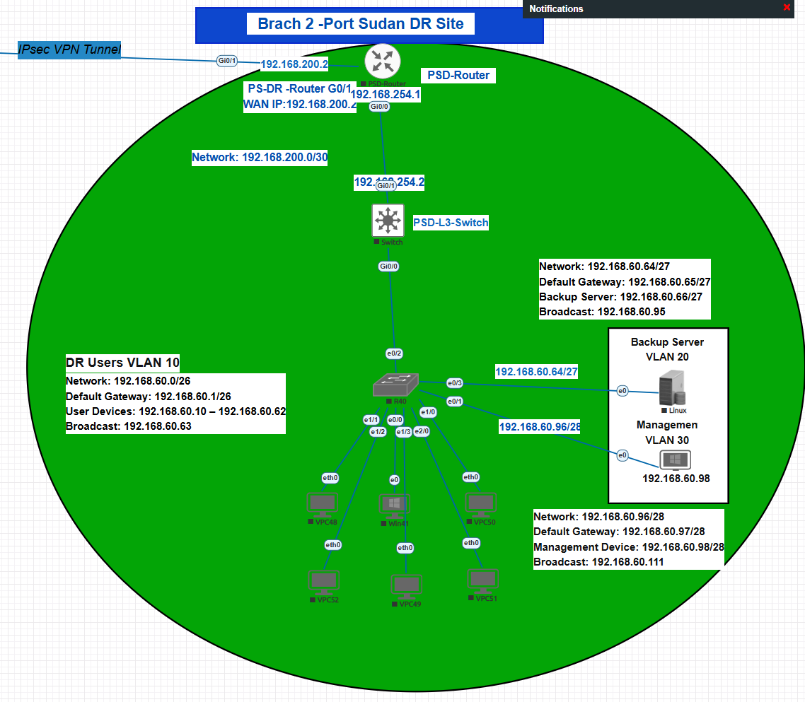
* **الصورة:** `12_Branch2_Port_Sudan_DR_Topology.png`
* **الشرح التقني:** تصميم موقع التعافي من الكوارث في بورتسودان (PSD Router) بنطاق `192.168.200.0/24` لضمان استمرارية الأعمال عند الأزمات.

---

### [القسم الثالث: أتمتة الشبكات والاستجابة للتهديدات بلغة بايثون (Python NetDevOps)]

#### 12. Network Automation Script with Python & Netmiko (كود بايثون لأتمتة أجهزة سيسكو)
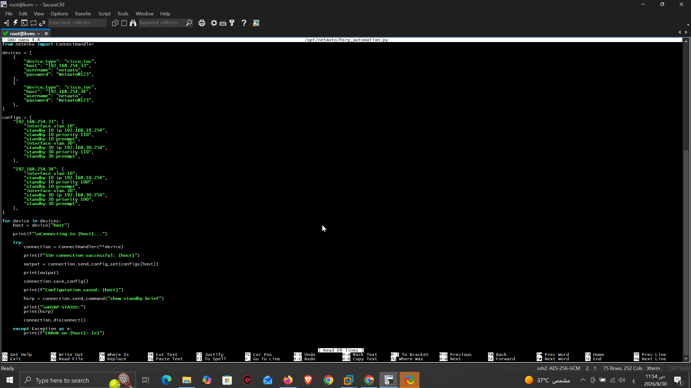
* **الصورة:** `02_Network_Automation_Netmiko_Script.png`
* **الشرح التقني:** كود بايثون متكامل باستخدام مكتبة **Netmiko** للاتصال المشفر بأجهزة سيسكو دفعة واحدة وبرمجة إعدادات الأمان وبروتوكول HSRP تلقائياً.

#### 13. Automated Threat Response Engine (محرك الاستجابة التلقائية للتهديدات)
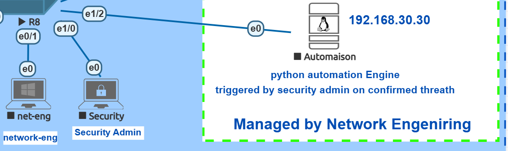
* **الصورة:** `03_Automated_Threat_Response_Engine.png`
* **الشرح التقني:** محرك الأتمتة الأمني المرتبط بالمشرف لحظر عناوين IP المهاجمة تلقائياً عبر قوائم التحكم بالوصول (ACLs) على راوترات الحافة فور تأكيد الاختراق.

#### 14. HSRP High Availability & Failover Validation (اختبار تجاوز الفشل لبروتوكول HSRP)
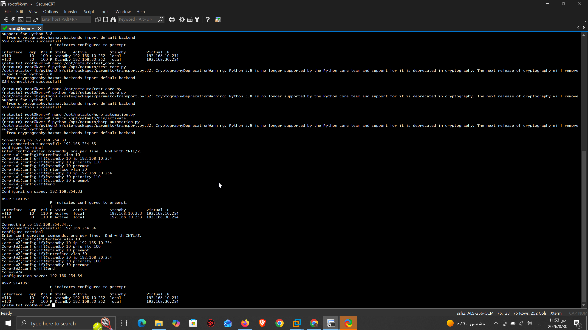
* **الصورة:** `13_HSRP_High_Availability_Failover_Test.png`
* **الشرح التقني:** اختبار ميداني لبروتوكول HSRP للتأكد من تحول الراوتر الاحتياطي إلى الفعلي فور تعطل الراوتر الأساسي دون أي انقطاع.

#### 15. Automated Configuration Backup via Python (النسخ الاحتياطي المؤتمت للإعدادات)
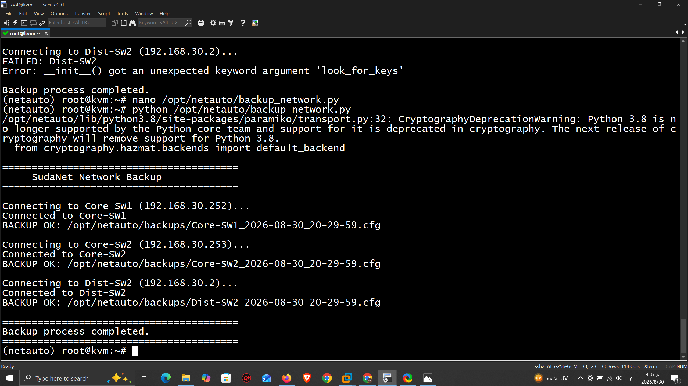
* **الصورة:** `14_Automated_Config_Backup_Python.png`
* **الشرح التقني:** سكربت بايثون لسحب نسخ الـ Running-Configuration تلقائياً من كافة الراوترات والسويتشات وأرشفتها.

#### 16. Automated VLAN Provisioning & Port Assignment (أتمتة إنشاء شبكات الـ VLAN)
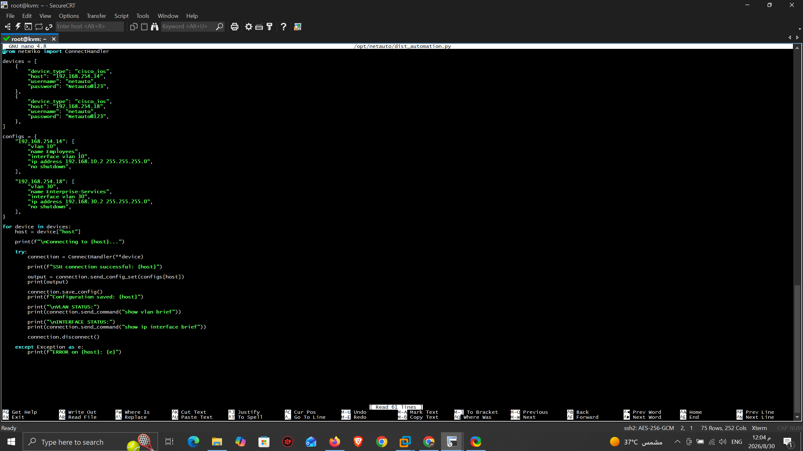
* **الصورة:** `15_Automated_VLAN_Provisioning.png`
* **الشرح التقني:** سكربت أتمتة يقوم بإنشاء شبكات VLAN وتسميتها وتعيين المنافذ وتفعيل الـ Trunking على السويتشات برمجياً.

---

### [القسم الرابع: الدفاع السيبراني والجدران النارية ومصائد الاختراق (Cyber Defense & SecOps)]

#### 17. Cowrie SSH Honeypot & Elasticsearch Logs (مصيدة الاختراق وتحليل السجلات)
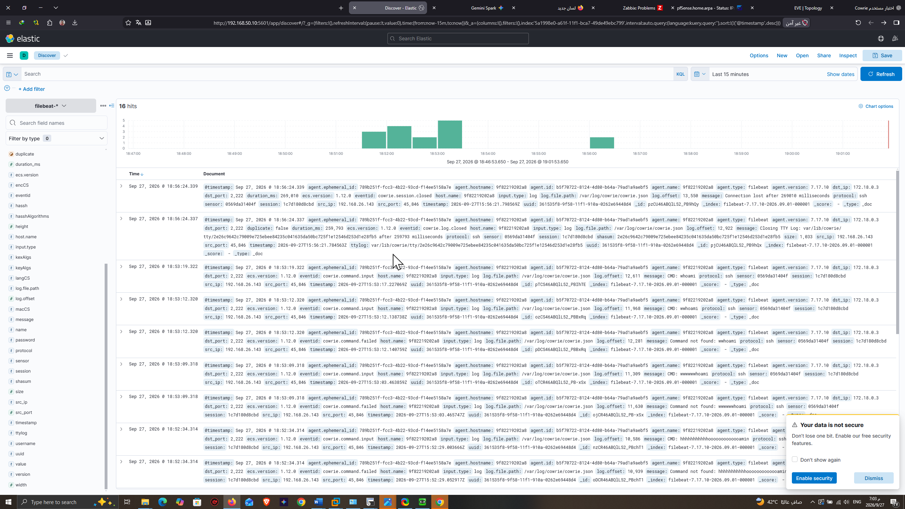
* **الصورة:** `04_Proactive_Defense_Cowrie_Honeypot.png`
* **الشرح التقني:** واجهة منصة Elasticsearch / Kibana المتصلة بمصيدة الاختراق Cowrie لرصد تحركات المخترقين داخل الـ DMZ.

#### 18. pfSense Perimeter Firewall & DMZ Rules (جدار الحماية وعزل الخوادم)
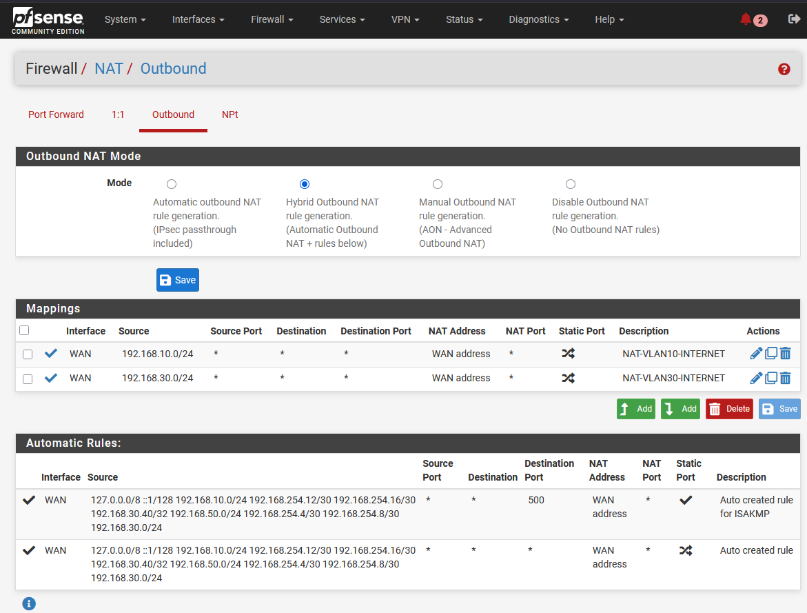
* **الصورة:** `08_Perimeter_Security_pfSense_Rules.png`
* **الشرح التقني:** واجهة إدارة pfSense وقواعد تصفية الحزم وتوجيه المنافذ وعزل شبكة DMZ لحماية الشبكة الداخلية.

#### 19. Encrypted Site-to-Site IPsec VPN Tunnels (أنفاق الربط المشفرة بين الفروع)
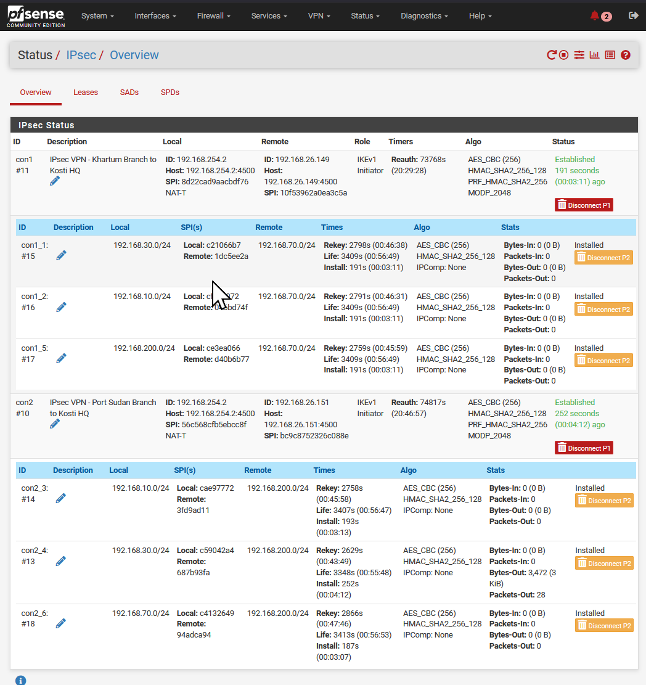
* **الصورة:** `09_Encrypted_IPsec_VPN_Tunnels.png`
* **الشرح التقني:** حالة أنفاق الربط المشفرة IPsec VPN بين المقر الرئيسي والفروع بتشفير AES-256 و SHA-256.

#### 20. Kali Linux Security Auditing & SSH Keys (مختبر كالي لينكس الأمني)
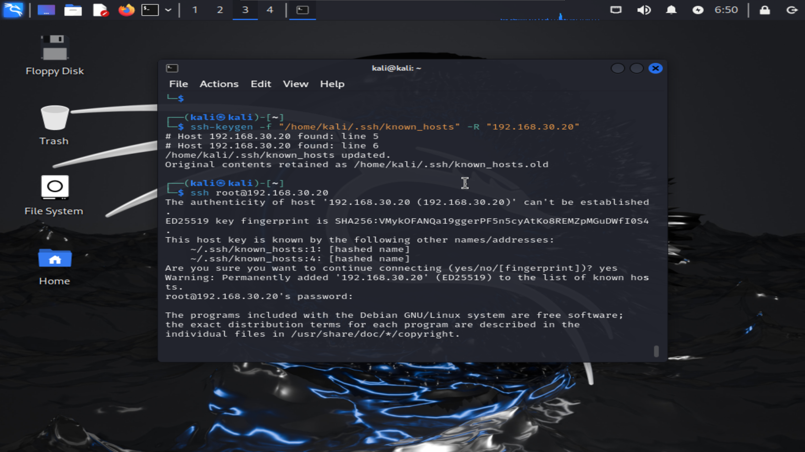
* **الصورة:** `18_Kali_Linux_Security_Auditing.png`
* **الشرح التقني:** محطة عمل Kali Linux لاختبار الاختراق وتوليد مفاتيح SSH وفحص صلابة إعدادات الشبكة.

---

### [القسم الخامس: المراقبة اللحظية وخوادم ويندوز (Monitoring & Windows Server Systems)]

#### 21. Infrastructure Monitoring with Zabbix (المراقبة اللحظية لنظام Zabbix)
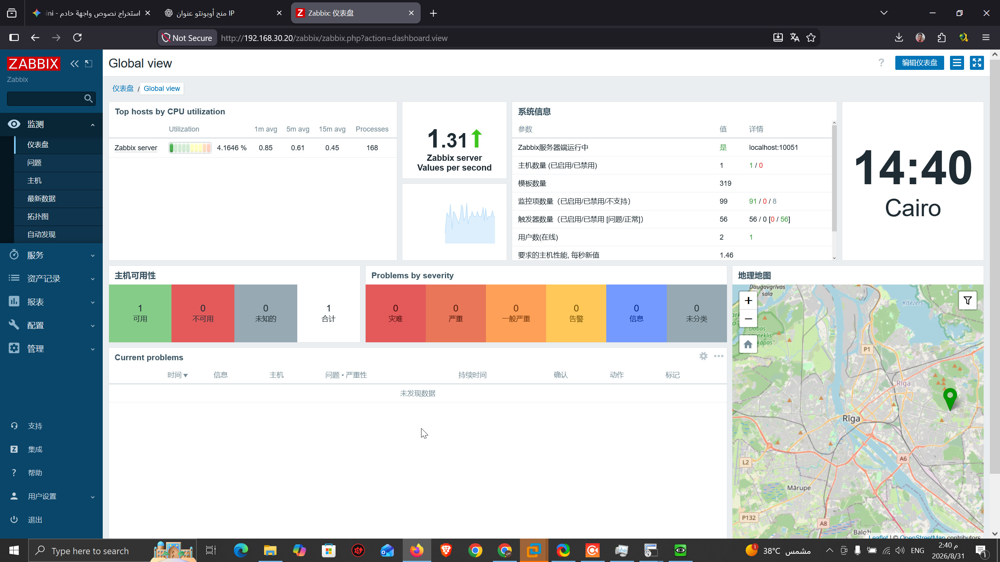
* **الصورة:** `05_Infrastructure_Monitoring_Zabbix.png`
* **الشرح التقني:** لوحة قيادة Zabbix المركزية لمراقبة الراوترات والسويتشات والخوادم والتنبيه التلقائي للأعطال.

#### 22. Windows Server Active Directory Infrastructure (إدارة الهوية ونطاق الدومين)
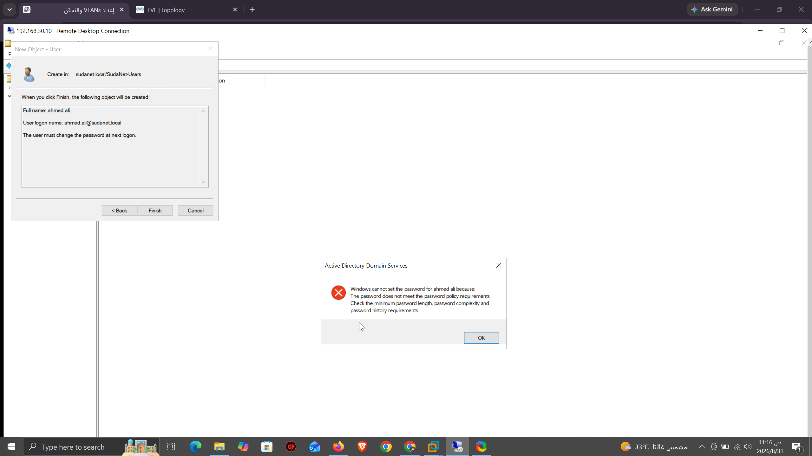
* **الصورة:** `06_Windows_Server_Active_Directory.png`
* **الشرح التقني:** إدارة نطاق `sudanet.local` عبر Windows Server وإنشاء المستخدمين وتطبيق سياسات المجموعة GPO.

#### 23. Domain Client Authentication Test (اختبار مصادقة المستخدمين في النطاق)
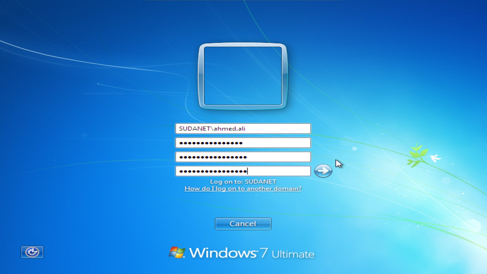
* **الصورة:** `07_Domain_Authentication_Client_Test.jpg`
* **الشرح التقني:** إثبات نجاح تسجيل دخول مستخدم حقيقي (`SUDANET\ahmed.ali`) في النطاق المركزي للمؤسسة.

#### 24. Windows Server DNS Manager (خادم أسماء النطاقات وسجلات A Records)
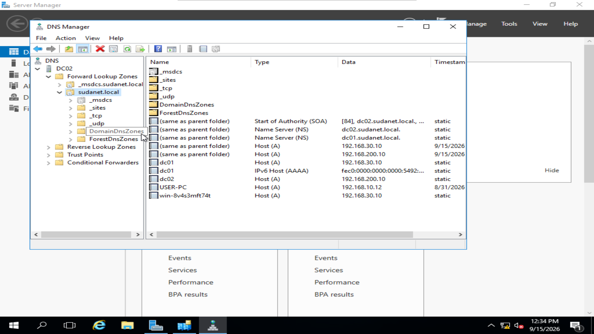
* **الصورة:** `16_Windows_Server_DNS_Manager.png`
* **الشرح التقني:** واجهة DNS Manager وسجلات البحث المباشر لراوترات وسويتشات وخوادم النطاق.

#### 25. Windows Server DHCP Scope & Leases (توزيع العناوين الآلي لنطاقات الشبكة)
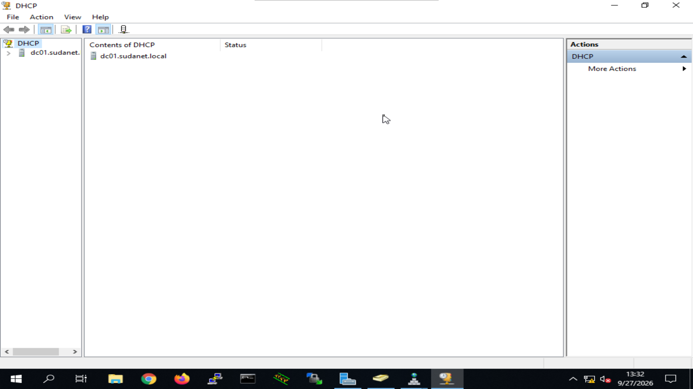
* **الصورة:** `17_Windows_Server_DHCP_Scope.png`
* **الشرح التقني:** نطاقات عناوين DHCP Scopes وعناوين IP المؤجرة للأجهزة في مختلف أقسام المؤسسة.

---

## 📋 Ready-to-Copy GitHub Markdown Snippet (كود النسخ المباشر لمستودعك)

```markdown
### 🚀 SudaNet Enterprise Showcase (25 Comprehensive Visual Artifacts)

| سويتش القلب المركزي (Core-SW2 CLI) | سويتش التوزيع (Dist-SW1 CLI) |
| :---: | :---: |
|  |  |

| تكوين سويتش MLS DS2 وشبكة VLAN 30 | أوامر التوجيه وهندسة سيسكو (Cisco CLI) |
| :---: | :---: |
|  |  |

| تكوين الراوتر الرئيسي الأول (R1 Config) | راوتر فرع بورتسودان (PSD-Router CLI) |
| :---: | :---: |
|  |  |

| ربط سويتش القلب بسويتش التوزيع الثاني | ربط سويتش التوزيع بسويتش الوصول |
| :---: | :---: |
|  |  |

| المخطط الهيكلي العام (EVE-NG Topology) | أتمتة الشبكات بالبايثون (Python Netmiko) |
| :---: | :---: |
|  |  |

| الاستجابة التلقائية للتهديدات | الدفاع الاستباقي ومصيدة Cowrie |
| :---: | :---: |
|  |  |

| المراقبة اللحظية (Zabbix) | إدارة الهوية (Windows Server AD) |
| :---: | :---: |
|  |  |

| اختبار مصادقة المستخدمين في الدومين | جدار الحماية وعزل الخوادم (pfSense) |
| :---: | :---: |
|  |  |

| أنفاق الربط المشفرة (IPsec VPN) | تفاصيل فرع الخرطوم (Khartoum NOC) |
| :---: | :---: |
|  |  |

| موقع الطوارئ (Port Sudan DR Site) | اختبار الوفرة العالية (HSRP Failover) |
| :---: | :---: |
|  |  |

| النسخ الاحتياطي المؤتمت (Python Backup) | أتمتة شبكات الـ VLAN |
| :---: | :---: |
|  |  |

| خادم أسماء النطاقات (Windows DNS) | توزيع العناوين الآلي (Windows DHCP) |
| :---: | :---: |
|  |  |

| مختبر كالي لينكس واختبار الاتصال | معمارية الربط والأمان الشامل |
| :---: | :---: |
|  |  |
```

---
**Engineer:** Mahmoud Mohamed Saeed  
**Email:** Mahamud199mohamed@gmail.com | **Phone:** +249 090 462 8457
